I build at the intersection of **computer graphics, intelligent tools, and interactive experiences**. My work moves between Houdini-generated 3D assets, browser-based visual worlds, and practical AI agent workflows.

I care about the details that make a project usable: visual quality, reproducible builds, clear boundaries, and evidence that a fix actually works.

<b><a href="https://digitalgarden.si/">Digital Garden</a></b> · <b><a href="https://aliciawque.github.io/">Personal blog</a></b> · <b><a href="https://x.com/EmberAtelier">X / @EmberAtelier</a></b>

## Selected work

| Project | What it does |
| :--- | :--- |
| [Digital Garden ↗](https://digitalgarden.si/) · [Showcase](https://github.com/Aliciawque/digital-garden-showcase) | An interactive four-season 3D flower garden for the browser, built with Houdini assets and Three.js. |
| [Visual Attraction](https://github.com/Aliciawque/visual-attraction) | An agent skill for evidence-based visual critique: composition, color, typography, UI and product presentation. |
| [Personalized Agent Forge](https://github.com/Aliciawque/openclaw-personalized-agent-forge) | An OpenClaw skill collection for building creator, professional and fictional-character agents. |
| [Clip Log Preflight](https://github.com/Aliciawque/clip-log-preflight) | A read-only Python CLI that checks episode clip logs against local camera and card folders before editing. |
| [Alicia.dev](https://aliciawque.github.io/) · [Source](https://github.com/Aliciawque/Aliciawque.github.io) | My bilingual creative-coding blog, with ASCII-inspired interactions and an Astro front end. |

## Recent experiments

- [Codex + machine-skill](https://digitalgarden.si/blog/codex-machine-skill-threejs/) — Two Three.js pump simulations with solver checks, screenshots and downloadable demos. (2026-10-18)
- [Houdini Solaris → OpenUSD → Three.js](https://digitalgarden.si/blog/openusd-threejs-usd-web-viewer/) — Tested formats, instancing, materials and loader limits. (2026-10-16)

## Merged open-source contributions

Selected PRs **merged into other maintainers' repositories**. Each link goes to the actual review and merge record.

| Upstream project | Contribution | PR |
| :--- | :--- | :--- |
| [REA](https://github.com/morluto/rea) | Fixed plist XML dictionary-key handling while preserving ordinary values and omission reporting. | [#1843](https://github.com/morluto/rea/pull/1843) |
| [agent-skills](https://github.com/addyosmani/agent-skills) | Required non-empty evidence in evaluation grading results. | [#666](https://github.com/addyosmani/agent-skills/pull/666) |
| [codex-island](https://github.com/ericjypark/codex-island) | Made Sparkle extraction and build-cache recovery more resilient. | [#106](https://github.com/ericjypark/codex-island/pull/106) |
| [iFixAi](https://github.com/ifixai-ai/iFixAi) | Fixed custom API endpoint propagation in self-evaluation mode. | [#17](https://github.com/ifixai-ai/iFixAi/pull/17) |

## What I'm exploring

- **Procedural art:** parameterized 3D assets, real-time rendering, and interactive storytelling.
- **Agent workflows:** tools that connect AI-assisted development with real software and reviewable outcomes.
- **Creative engineering:** thoughtful UX, reproducible pipelines, and small utilities that solve real problems.

---

**中文 / 简介**

我是 Alicia，一名关注 **程序化 3D、实时图形、AI Agent 与创意编程** 的技术艺术创作者。我喜欢用 Houdini、Three.js 和自动化工具创造可交互的数字世界，也参与开源项目的修复与改进。

🌱 [体验数字花园](https://digitalgarden.si/) · 📝 [个人博客](https://aliciawque.github.io/) · ✦ [GitHub 项目](https://github.com/Aliciawque?tab=repositories)

